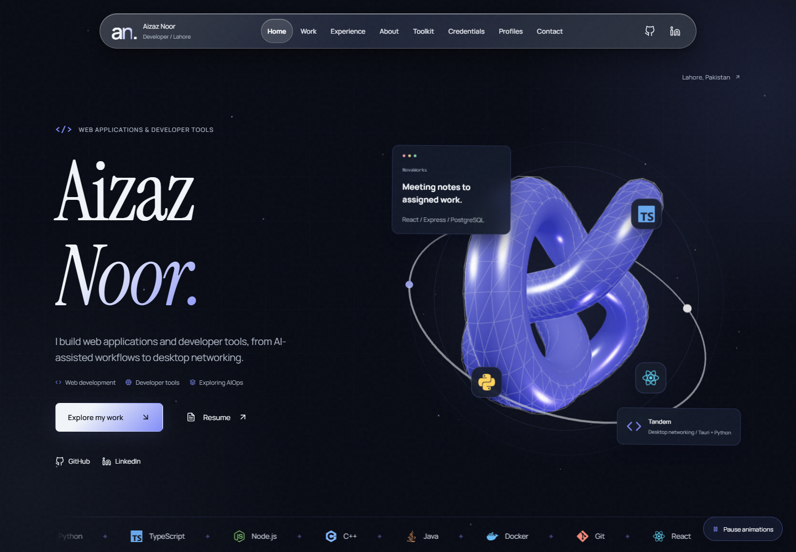
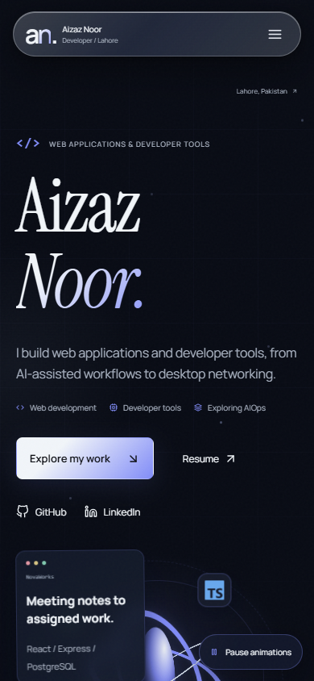

# Aizaz Noor Portfolio

**First public release · 1.0.0**

A personal portfolio by a software engineering student and freelance developer based in Lahore, Pakistan. Explore selected web and desktop projects, the decisions behind them, and ways to collaborate.

**[Visit the portfolio](https://aizaznoorkhuwaja.vercel.app/)** · [GitHub](https://github.com/Aizaz-Noor) · [LinkedIn](https://www.linkedin.com/in/aizaz-noor/)



## Highlights

- **Work with context:** project stories explain the problem, approach, outcome, and individual contributions, with source and demo links.
- **Interactive previews:** inspect real application screenshots in keyboard-accessible dialogs.
- **Considered motion:** a monogram introduction, desktop 3D artwork, scroll reveals, orbiting technology icons, and a persistent animation pause control.
- **Portrait interaction:** a grayscale photograph reveals color beneath the pointer, with a static color fallback on touch devices.
- **Responsive experience:** layouts for mobile and desktop, reduced-motion support, and readable content when JavaScript is unavailable.
- **Get in touch:** validated contact form, public GitHub activity, credentials, and a résumé available from the hero.

The page follows a simple story: introduction → about → selected work → experience → toolkit → credentials → contact.

<details>
<summary>Mobile preview</summary>



</details>

## Built with

| Area | Tools |
| --- | --- |
| Application | React 19, JavaScript, Vite 8 |
| Visuals | CSS, Web Animations API, Three.js, React Three Fiber |
| Typography and icons | Self-hosted Manrope and Instrument Serif, React Icons |
| Integrations | Web3Forms, public GitHub activity service |
| Quality checks | ESLint, Node test runner, Playwright, axe-core |
| Deployment | GitHub Actions, Vercel |

## Run locally

Use Node.js `^20.19.0 || >=22.12.0` and npm.

```sh
git clone https://github.com/Aizaz-Noor/MyCV.git
cd MyCV
npm ci
npm run dev
```

Open the URL printed by Vite, normally `http://localhost:5173`. On Windows, use `npm.cmd` if PowerShell blocks `npm.ps1`.

For your own contact account, set `VITE_WEB3FORMS_ACCESS_KEY` in a local `.env` file. The application retains its existing public fallback key. Vite exposes these values to browsers; never use them for server secrets. Configure recipient settings and domain restrictions in Web3Forms.

## Validate and preview

```sh
npm run lint
npm test
npm run build
npm audit --audit-level=low
npx playwright install chromium
npm run test:browser
npm run preview
```

Browser tests cover responsive layouts, navigation, dialogs, contact validation, motion preferences, startup recovery, portrait interactions, and automated accessibility checks. See [development notes](docs/DEVELOPMENT.md) for setup, architecture, and verification limits.

## Project structure

```text
src/
  components/   Shared UI, dialogs, graphics and motion
  context/      Shared motion preferences
  data/         Project content and attribution
  hooks/        Navigation and graphics lifecycle
  pages/        Portfolio sections
  services/     Contact delivery and GitHub activity
public/         Images, credentials, résumé and licensed fonts
e2e/            Browser regression tests
tests/          Service unit tests
docs/           Preview images and maintenance notes
```

## Deployment

Pushes to `main` run [GitHub Actions checks](.github/workflows/checks.yml) and trigger the connected Vercel deployment. The production build is generated with `npm run build` in `dist/`. Confirm both CI and the public deployment after changes.

## Release and attribution

See the [1.0.0 release notes](CHANGELOG.md), [screenshot provenance](docs/project-image-provenance.json), and [font licenses and sources](public/fonts/README.md).

NovaWorks is a Code Nomads team project; the portfolio identifies Aizaz's contribution. Tandem's multi-adapter speed gains remain unverified. Screenshots preserve their actual interface context.

This repository does not currently declare a software license. Fonts include their SIL Open Font Licenses; dependencies retain their respective licenses.
